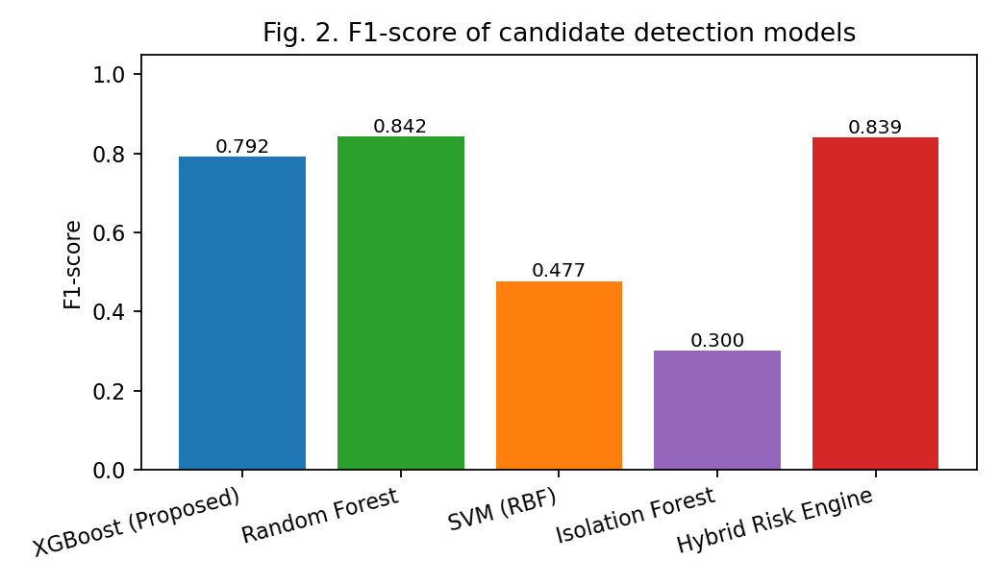

# Real-Time Intrusion Detection System for UPI Payments using AI & Machine Learning

[](https://www.python.org/) [](LICENSE) [](tests/)

Reference implementation of the paper **"Real-Time Intrusion Detection System for UPI Payments Using AI and Machine Learning"**
(Yasha Istwal, Hitesh Kumar, Raj Aryan, Raghvendra Pandey, Shivam Kumar — G.L. Bajaj Institute of Technology and Management, Greater Noida).
The paper is included at [`docs/Research_Paper.pdf`](docs/Research_Paper.pdf).

The project implements the paper's **modular hybrid real-time intrusion-detection framework** end to end:

```
Transaction Ingestion -> Preprocessing & Feature Extraction -> Parallel Detection Engines
      -> Weighted Risk Scoring -> Policy Decision Engine -> Alerts & Dashboard -> Monitoring & Feedback
```

| Paper section | Implementation |
|---|---|
| III-B Transaction generation & event streaming | `upi_ids/data/generator.py` (configurable synthetic UPI generator with 5 fraud scenarios), `upi_ids/streaming/` (in-memory pub/sub bus, optional Apache Kafka) |
| III-C Authentication & secure access | `upi_ids/api/security.py` — JWT (HS256), salted PBKDF2 password hashing, emulated MFA one-time codes, token-bucket rate limiting |
| III-D Preprocessing & feature extraction | `upi_ids/preprocessing/pipeline.py` (schema validation, keyed-hash PII anonymisation, imputation, de-duplication, encoding) and `upi_ids/features/extractor.py` (Table II feature space: `z_amt`, Haversine `Distance_From_Home`, `Txn_Count_1Hr`, `Inter_Txn_Gap`, `Device_Fingerprint`, ...) backed by a Redis-style velocity cache |
| III-E-1 Rule-based engine | `upi_ids/engines/rules.py` — excessive amount, transaction bursts, repeated auth failures, impossible travel, new device + abnormal amount |
| III-E-2 Supervised engine (XGBoost) | `upi_ids/engines/supervised.py` — XGBoost with class-weighted loss, SMOTE applied strictly to the training partition (`engines/imbalance.py`), plus RF / SVM-RBF / DT / LR / MLP baselines |
| III-E-3 Unsupervised engine (Isolation Forest) | `upi_ids/engines/anomaly.py` — normalised anomaly severity in [0, 1] |
| III-F Weighted risk scoring & policy engine | `upi_ids/scoring/risk.py` — `R(x) = w_r*rule + w_s*p_xgb + w_a*anomaly`, thresholds τ1 < τ2 < τ3 → **Approve / Challenge / Alert / Block** |
| III-G Dashboard & explainability | `upi_ids/explain/shap_explainer.py` (SHAP TreeExplainer per-transaction attributions) and a React admin dashboard served at `/` (`upi_ids/api/dashboard/index.html`) |
| III-H Monitoring, drift & governance | `upi_ids/monitoring/drift.py` (PSI concept-drift monitor), `upi_ids/monitoring/audit.py` (hash-chained immutable audit log) |
| IV REST API gateway / microservices | `upi_ids/api/app.py` (FastAPI), `Dockerfile`, `docker-compose.yml` (API + Redis + PostgreSQL + Kafka) |
| V–VII Experiments, metrics, figures, latency | `upi_ids/evaluation/` — reproduces Tables III–V, Fig. 2–4, SHAP importance and the latency benchmark |

## Quick start

```bash
git clone https://github.com/yasharyan90/upi-fraud-ids.git
cd upi-fraud-ids
pip install -r requirements.txt
pip install -e .

# 1. Reproduce the paper's experiments (tables, SHAP, latency, figures -> results/)
upi-ids experiment

# 2. Train + persist the hybrid detector
upi-ids train

# 3. Serve the REST API gateway + React dashboard on http://localhost:8000
upi-ids serve --model results/models/hybrid_detector.pkl

# 4. Stream 2,000 synthetic transactions through the event bus and the detector
upi-ids simulate --n 2000 --model results/models/hybrid_detector.pkl

# 5. Score a single transaction from the CLI
upi-ids score '{"sender_vpa":"user1@upi","receiver_vpa":"mule9@upi","amount":82000,"merchant_type":"crypto","device_id":"new-phone","ip_address":"103.4.5.6","lat":12.97,"lon":77.59,"auth_failures":4}'

pytest -q   # run the test-suite
```

`python -m upi_ids.cli ...` works identically if you prefer not to install the console script. `make experiment|train|serve|simulate|test|docker` wraps the same commands.

### Docker

```bash
docker compose up --build      # API on :8000, Redis, PostgreSQL and Kafka side-cars
```

## REST API

| Method | Endpoint | Auth | Purpose |
|---|---|---|---|
| POST | `/auth/login` | – | Password login → JWT, or MFA challenge for analyst/admin accounts |
| POST | `/auth/mfa/verify` | – | One-time code verification → MFA-bound JWT |
| POST | `/api/v1/score` | service+ | Real-time scoring of one UPI transaction (decision, risk score, engine outputs, SHAP, latency) |
| POST | `/api/v1/score/batch` | service+ | Batch scoring |
| GET | `/api/v1/alerts` | analyst (MFA) | Recent Challenge / Alert / Block events for triage |
| GET | `/api/v1/stats` | any | Live decision counters |
| GET | `/api/v1/drift` | analyst (MFA) | PSI concept-drift report |
| GET | `/api/v1/audit/verify` | admin (MFA) | Verify the hash-chained audit log |
| GET | `/` | – | React dashboard |

Demo accounts: `gateway / gateway-secret` (service), `analyst / analyst-secret` and `admin / admin-secret` (MFA required; the emulated one-time code is printed by the server and returned as `demo_code` in the prototype).
Set `UPI_IDS_JWT_SECRET`, `REDIS_URL`, `UPI_IDS_MODEL` and `UPI_IDS_AUDIT_PATH` to override defaults. `scripts/demo_client.py` shows a complete login + scoring round-trip.

Example response of `POST /api/v1/score`:

```json
{
  "txn_id": "TXN1763800000123",
  "decision": "Block",
  "risk_score": 0.9312,
  "engines": {"rule_score": 1.0, "rules_triggered": ["EXCESSIVE_AMOUNT", "REPEATED_AUTH_FAILURE", "NEW_DEVICE_HIGH_AMOUNT"],
              "xgboost_probability": 0.9874, "isolation_forest_anomaly": 0.71},
  "explanation": {"base_value": -5.1, "attributions": [{"feature": "Txn_Amount", "value": 82000.0, "shap": 2.93}, "..."]},
  "latency_ms": {"features": 0.4, "rules": 0.05, "xgboost": 0.6, "isolation_forest": 2.0, "total": 3.9}
}
```

## Experimental results

The paper evaluates on a simulated UPI stream modelled after PaySim with **N = 10,000 transactions (9,900 legitimate / 100 fraud)**. Because no public real UPI dataset exists, this repository ships a configurable generator that produces the same imbalance and the behavioural, device and geospatial attributes of Table II. Running `upi-ids experiment` (seed 42, 40,000 training transactions from the preceding month, temporal split, SMOTE + class weights on the training partition only, decision thresholds calibrated on a time-ordered validation slice) gives:

| Algorithm | TP | FN | FP | TN | Acc. | Prec. | Recall | F1 | FPR | FNR |
|---|---|---|---|---|---|---|---|---|---|---|
| XGBoost (Proposed) | 82 | 18 | 25 | 9875 | 99.57% | 0.766 | 0.820 | 0.792 | 0.25% | 18.0% |
| Random Forest | 80 | 20 | 10 | 9890 | 99.70% | 0.889 | 0.800 | 0.842 | 0.10% | 20.0% |
| SVM (RBF) | 53 | 47 | 69 | 9831 | 98.84% | 0.434 | 0.530 | 0.477 | 0.70% | 47.0% |
| Isolation Forest | 38 | 62 | 115 | 9785 | 98.23% | 0.248 | 0.380 | 0.300 | 1.16% | 62.0% |
| Rule Engine | 25 | 75 | 2 | 9898 | 99.23% | 0.926 | 0.250 | 0.394 | 0.02% | 75.0% |
| Hybrid Risk Engine | 73 | 27 | 1 | 9899 | 99.72% | 0.986 | 0.730 | 0.839 | 0.01% | 27.0% |

For reference, the paper reports XGBoost at Acc 99.53 %, Precision 0.715, Recall 0.880, F1 0.789, FPR 0.35 % (TP 88 / FN 12 / FP 35 / TN 9,865). The numbers above come from the included synthetic generator and will differ in detail from the paper's benchmark run, but reproduce its qualitative findings: the tree ensembles are the strongest single models (in this synthetic run Random Forest edges XGBoost on F1 while XGBoost has the higher recall and roughly 180x lower per-transaction latency), SVM-RBF and standalone Isolation Forest trail far behind, and the hybrid risk engine drives false positives almost to zero while keeping recall high. Isolation Forest is a complementary zero-day indicator, not a blocking authority.

Hybrid policy decisions on the 10k batch: Approve = 9879, Alert = 52, Challenge = 47, Block = 22.

**Per-transaction latency** (single-row calls, Apple-silicon laptop, Python):

| Engine | mean (ms) | p95 (ms) |
|---|---|---|
| Rule Engine | 0.12 | 0.13 |
| XGBoost (Proposed) | 0.08 | 0.08 |
| Isolation Forest | 2.01 | 2.06 |
| Random Forest | 14.70 | 15.61 |
| SVM (RBF) | 0.13 | 0.14 |
| Hybrid (sequential 3 engines + policy) | 2.19 | 2.26 |
| Hybrid (parallel bound = slowest branch) | 2.01 | 2.06 |

All engines score well inside the paper's < 50 ms real-time gateway budget; the full streaming path including SHAP attribution runs at ≈ 4 ms/transaction (`upi-ids simulate`).

**Global SHAP importance** (mean |φ|, XGBoost):

| Feature | mean abs SHAP |
|---|---|
| Merchant_Type | 3.881 |
| Inter_Txn_Gap | 1.203 |
| Txn_Amount | 1.161 |
| z_amt | 1.037 |
| Distance_From_Home | 0.706 |
| Hour_Of_Day | 0.693 |

Figures are written to `results/figures/`: `fig2_f1_comparison.png`, `fig3_fpr_vs_fnr.png`, `fig4_precision_recall_isoF1.png`, `shap_global_importance.png`, `latency_per_engine.png`. Full machine-readable output is in `results/metrics.json` and `results/results_tables.md`.




## Configuration

Everything is driven by [`configs/default.yaml`](configs/default.yaml): dataset sizes and fraud rate, SMOTE / class-weight settings, XGBoost and Isolation Forest hyper-parameters, rule thresholds, risk weights `(w_r, w_s, w_a)`, policy thresholds `(τ1, τ2, τ3)`, API security and drift settings. Pass `--config my.yaml` to any CLI command.

## Project layout

```
upi_ids/
  data/generator.py          synthetic UPI transaction + fraud-scenario generator
  preprocessing/pipeline.py  validation, PII anonymisation, imputation, dedup, encoding
  features/                  behavioural feature extraction + velocity cache (memory / Redis)
  engines/                   rules.py, supervised.py (XGBoost + baselines), anomaly.py (Isolation Forest), imbalance.py (SMOTE)
  scoring/risk.py            weighted risk aggregation + Approve/Challenge/Alert/Block policy
  explain/shap_explainer.py  SHAP TreeExplainer attributions
  monitoring/                PSI drift monitor, hash-chained audit log
  streaming/                 event bus (in-memory / Kafka) + stream consumer
  api/                       FastAPI gateway, security layer, React dashboard
  evaluation/                metrics, benchmark, figures
  pipeline.py                HybridDetector (train / score / save / load)
  cli.py                     upi-ids command-line interface
configs/default.yaml  docs/Research_Paper.pdf  results/  scripts/  tests/
```

## Limitations

As in the paper, this is a research prototype evaluated on simulated data, not a system integrated with live banking rails. Known open problems discussed in Section VIII — adversarial evasion and concept drift, and the cold-start problem for users without a behavioural baseline — are only partially mitigated here (PSI drift alerts with scheduled retraining; cold-start fallback to relative amount deviation).

## Citation

```bibtex
@article{istwal2026upiids,
  title   = {Real-Time Intrusion Detection System for UPI Payments Using AI and Machine Learning},
  author  = {Istwal, Yasha and Kumar, Hitesh and Aryan, Raj and Pandey, Raghvendra and Kumar, Shivam},
  year    = {2026},
  note    = {G.L. Bajaj Institute of Technology and Management, Greater Noida, India}
}
```

## License

MIT — see [LICENSE](LICENSE).
