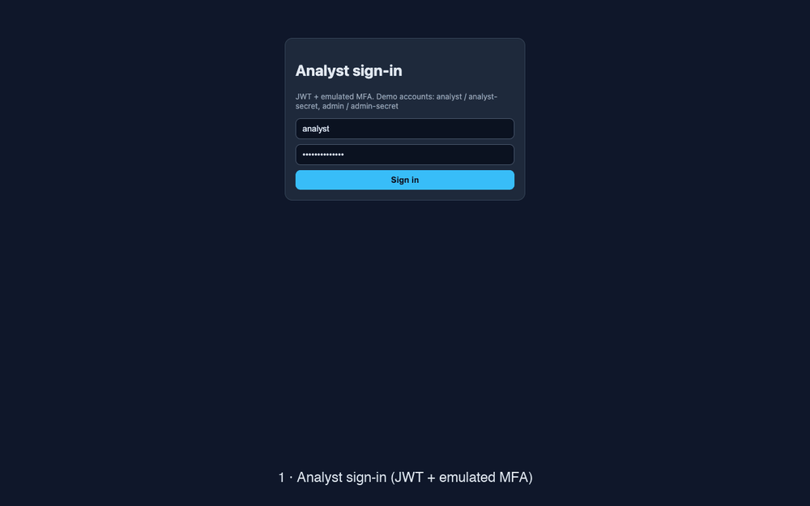
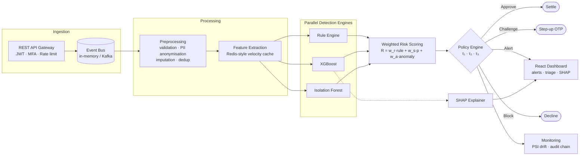
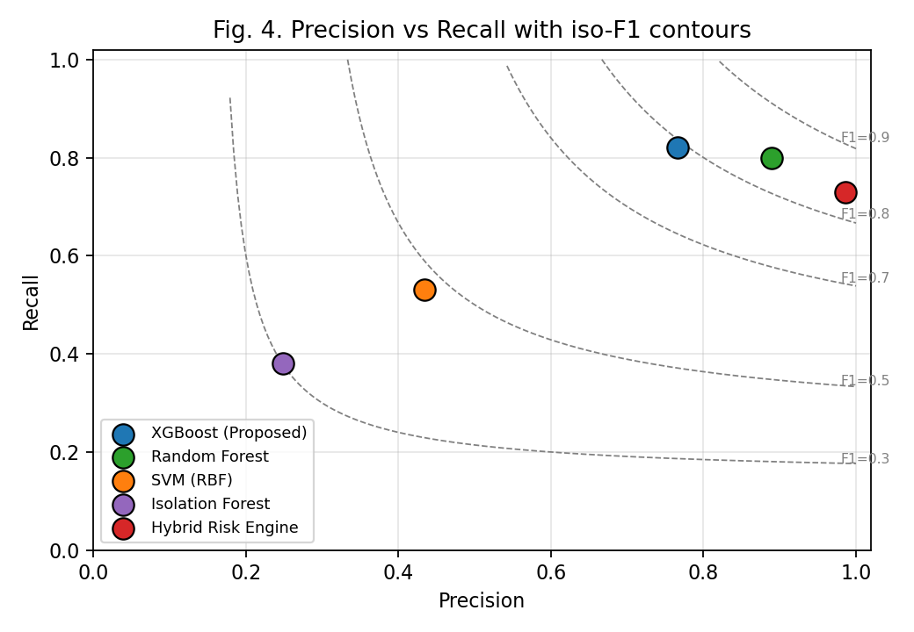
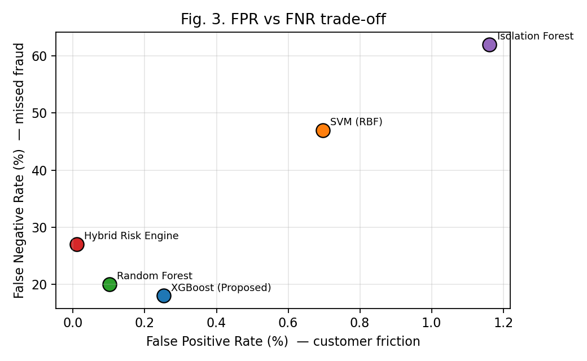
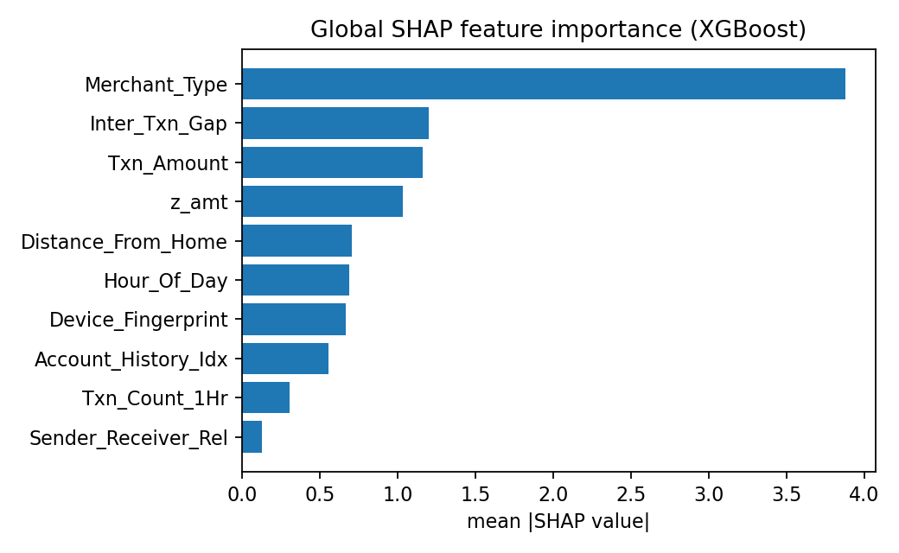
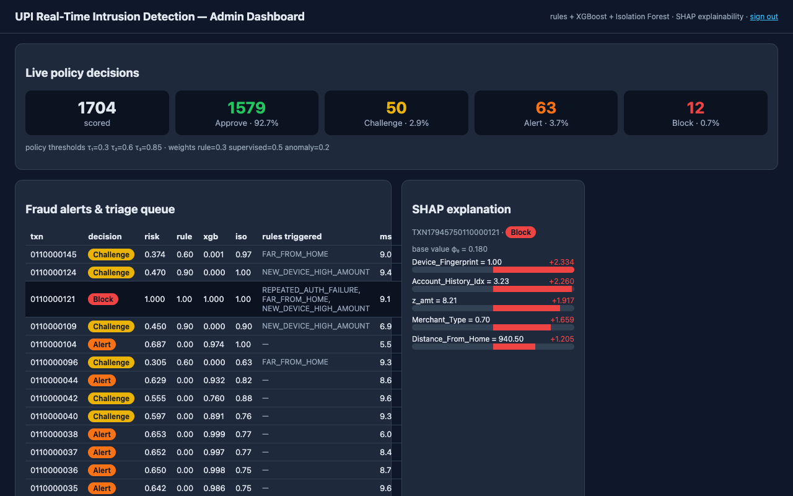

<div align="center">

# 🛡️ UPI Real-Time Intrusion Detection System

**A hybrid AI/ML framework for real-time fraud detection on Unified Payments Interface (UPI) transactions**
<br/>Rule engine · XGBoost · Isolation Forest · Weighted risk scoring · SHAP explainability · Sub-5 ms latency

[](https://www.python.org/)
[](https://fastapi.tiangolo.com/)
[](https://xgboost.readthedocs.io/)
[](https://scikit-learn.org/)
[](https://shap.readthedocs.io/)
[](docker-compose.yml)
[](tests/)
[](LICENSE)

[Overview](#-overview) · [Architecture](#-architecture) · [Quick Start](#-quick-start) · [Results](#-experimental-results) · [REST API](#-rest-api) · [Dashboard](#-dashboard) · [Configuration](#-configuration) · [Paper](#-paper--citation)

</div>

<p align="center">
  
  <br/><sub>Live demo: analyst sign-in with emulated MFA → real-time policy decisions → fraud triage queue with per-transaction SHAP attributions → PSI concept-drift monitor</sub>
</p>

---

## 📖 Overview

This repository is the reference implementation of the research paper
**"Real-Time Intrusion Detection System for UPI Payments Using AI and Machine Learning"**
(G.L. Bajaj Institute of Technology and Management, Greater Noida, India — [`docs/Research_Paper.pdf`](docs/Research_Paper.pdf)).

The explosive adoption of UPI has made real-time payments ubiquitous — and expanded the attack surface for payment fraud. Traditional rule-based engines rely on static thresholds and fail against adaptive attackers. This project implements the paper's **modular, defence-in-depth detection pipeline** that combines three complementary engines and maps their fused risk score to an enforceable policy action, all within a real-time payment gateway's latency budget.

```
Transaction Ingestion ─► Preprocessing & Feature Extraction ─► Parallel Detection Engines
        ─► Weighted Risk Scoring ─► Policy Decision Engine ─► Alerts & Dashboard ─► Monitoring & Feedback
```

### Key capabilities

| | Capability | Details |
|---|---|---|
| ⚙️ | **Three parallel detection engines** | Deterministic rule engine, supervised **XGBoost** classifier, unsupervised **Isolation Forest** anomaly detector |
| 🧮 | **Weighted risk scoring** | `R(x) = w_r·rule(x) + w_s·p_xgb(x) + w_a·anomaly(x)` with calibrated weights |
| 🚦 | **Policy decision engine** | Thresholds τ₁ < τ₂ < τ₃ map risk to **Approve · Challenge (MFA) · Alert (analyst) · Block** |
| 🔍 | **Explainable by design** | Per-transaction **SHAP** (TreeExplainer) attributions for regulatory auditability |
| 📐 | **Behavioural feature space** | Amount Z-score vs. 30-day profile, Haversine distance from home, 1-hour velocity, inter-transaction gap, device fingerprint, peer relationship, account history |
| ⚖️ | **Imbalance-aware training** | SMOTE + class-weighted loss applied strictly inside the training partition (no leakage) |
| 🔐 | **Secure gateway** | JWT authentication, salted PBKDF2 password hashing, emulated MFA, token-bucket rate limiting |
| 📡 | **Streaming ingestion** | Pub/sub event bus — in-memory by default, **Apache Kafka** optional |
| 🧾 | **Governance** | Keyed-hash PII anonymisation, **hash-chained immutable audit log**, **PSI concept-drift monitor** |
| 📊 | **Live dashboard** | React admin console: decision tiles, triage queue, SHAP panel, drift status |
| ⚡ | **Real-time** | ≈ 2 ms hybrid scoring, ≈ 4 ms including SHAP — well under the 50 ms gateway budget |
| 🔁 | **Reproducible research** | One command regenerates every table, figure and latency benchmark of the paper |

---

## 🏗 Architecture



### Paper-to-code map

| Paper section | Module |
|---|---|
| III-B Transaction generation & event streaming | [`upi_ids/data/generator.py`](upi_ids/data/generator.py), [`upi_ids/streaming/`](upi_ids/streaming/) |
| III-C Authentication & secure access | [`upi_ids/api/security.py`](upi_ids/api/security.py) |
| III-D Preprocessing & feature extraction | [`upi_ids/preprocessing/pipeline.py`](upi_ids/preprocessing/pipeline.py), [`upi_ids/features/`](upi_ids/features/) |
| III-E-1 Rule-based detection | [`upi_ids/engines/rules.py`](upi_ids/engines/rules.py) |
| III-E-2 Supervised engine (XGBoost + baselines) | [`upi_ids/engines/supervised.py`](upi_ids/engines/supervised.py), [`upi_ids/engines/imbalance.py`](upi_ids/engines/imbalance.py) |
| III-E-3 Unsupervised engine (Isolation Forest) | [`upi_ids/engines/anomaly.py`](upi_ids/engines/anomaly.py) |
| III-F Risk scoring & policy decision engine | [`upi_ids/scoring/risk.py`](upi_ids/scoring/risk.py) |
| III-G Dashboard & SHAP explainability | [`upi_ids/explain/shap_explainer.py`](upi_ids/explain/shap_explainer.py), [`upi_ids/api/dashboard/`](upi_ids/api/dashboard/) |
| III-H Monitoring, drift detection & governance | [`upi_ids/monitoring/`](upi_ids/monitoring/) |
| IV System architecture & implementation | [`upi_ids/api/app.py`](upi_ids/api/app.py), [`Dockerfile`](Dockerfile), [`docker-compose.yml`](docker-compose.yml) |
| V–VII Dataset, metrics, results & latency | [`upi_ids/evaluation/`](upi_ids/evaluation/) |

---

## 🚀 Quick Start

### Prerequisites

* Python **3.10+** (tested on 3.11 and 3.13)
* Optional: Docker Desktop for the containerised stack

### Installation

```bash
git clone https://github.com/yasharyan90/upi-fraud-ids.git
cd upi-fraud-ids
python -m venv .venv && source .venv/bin/activate      # Windows: .venv\Scripts\activate
pip install -r requirements.txt
pip install -e .
```

### Run the pipeline

```bash
# 1 · Reproduce the paper's experiments → results/metrics.json, results_tables.md, figures/
upi-ids experiment

# 2 · Train and persist the hybrid detector
upi-ids train

# 3 · Serve the REST API gateway + dashboard at http://localhost:8000
upi-ids serve --model results/models/hybrid_detector.pkl

# 4 · Stream 2,000 synthetic transactions through the event bus and the detector
upi-ids simulate --n 2000 --model results/models/hybrid_detector.pkl

# 5 · Score a single transaction from the command line
upi-ids score '{"sender_vpa":"user1@upi","receiver_vpa":"mule9@upi","amount":82000,
                "merchant_type":"crypto","device_id":"new-phone","ip_address":"103.4.5.6",
                "lat":12.97,"lon":77.59,"auth_failures":4}'

# Run the test-suite
pytest -q
```

> `python -m upi_ids.cli …` is equivalent to `upi-ids …`. A `Makefile` wraps the same commands (`make experiment|train|serve|simulate|test|docker`).

### Docker

```bash
docker compose up --build
```

Starts the API on port 8000 together with Redis (velocity cache), PostgreSQL (audit persistence) and Kafka (event streaming) side-cars. Set `UPI_IDS_JWT_SECRET` in your environment before exposing the service.

---

## 📊 Experimental Results

The paper evaluates on a simulated UPI stream modelled after the PaySim mobile-money benchmark, using **N = 10,000 transactions (9,900 legitimate / 100 fraudulent, 1 % fraud rate)**. No public real-world UPI dataset exists, so this repository ships a configurable generator that reproduces that imbalance together with the behavioural, device and geospatial attributes of Table II, across five fraud scenarios (account takeover, velocity burst, high-value mule transfer, night-time anomaly, subtle low-deviation fraud).

**Protocol** — seed 42 · 40,000 training transactions from the preceding month · strict temporal split · SMOTE + class weights on the training partition only · decision thresholds calibrated on a time-ordered validation slice · evaluated with `upi-ids experiment`.

### Comparative performance (N = 10,000)

| Algorithm | Accuracy | Precision | Recall | F1 | FPR | FNR |
|---|---|---|---|---|---|---|
| **XGBoost (Proposed)** | 99.57% | 0.766 | 0.820 | 0.792 | 0.25% | 18.0% |
| Random Forest | 99.70% | 0.889 | 0.800 | 0.842 | 0.10% | 20.0% |
| Decision Tree | 99.51% | 0.774 | 0.720 | 0.746 | 0.21% | 28.0% |
| MLP | 99.51% | 0.815 | 0.660 | 0.729 | 0.15% | 34.0% |
| Logistic Regression | 99.14% | 0.556 | 0.700 | 0.619 | 0.57% | 30.0% |
| SVM (RBF) | 98.84% | 0.434 | 0.530 | 0.477 | 0.70% | 47.0% |
| Isolation Forest | 98.23% | 0.248 | 0.380 | 0.300 | 1.16% | 62.0% |
| Rule Engine | 99.23% | 0.926 | 0.250 | 0.394 | 0.02% | 75.0% |
| **Hybrid Risk Engine** | 99.72% | 0.986 | 0.730 | 0.839 | 0.01% | 27.0% |

### Confusion matrices

| Algorithm | TP | FN | FP | TN |
|---|---|---|---|---|
| XGBoost (Proposed) | 82 | 18 | 25 | 9875 |
| Random Forest | 80 | 20 | 10 | 9890 |
| SVM (RBF) | 53 | 47 | 69 | 9831 |
| Isolation Forest | 38 | 62 | 115 | 9785 |
| Hybrid Risk Engine | 73 | 27 | 1 | 9899 |

<table>
<tr>
<td></td>
<td></td>
</tr>
<tr>
<td></td>
<td></td>
</tr>
</table>

**Interpretation.** The paper reports the proposed XGBoost engine at accuracy 99.53 %, precision 0.715, recall 0.880, F1 0.789 and FPR 0.35 % (TP 88 / FN 12 / FP 35 / TN 9,865). On this repository's synthetic benchmark XGBoost reaches **F1 0.792** at **FPR 0.25 %**, closely tracking the paper. The qualitative conclusions hold: tree ensembles dominate the single-model comparison (Random Forest edges XGBoost on F1 here, while XGBoost retains higher recall and ~180× lower inference latency), SVM-RBF and standalone Isolation Forest trail far behind, and the **hybrid risk engine** combines the engines into the best operating point for a payment gateway — **precision 0.986 with FPR 0.01 %**, i.e. virtually zero customer friction, while intercepting 73 % of fraud outright (a further 9 frauds are routed to step-up MFA). Isolation Forest acts as a complementary zero-day indicator, not a blocking authority, exactly as the paper argues.

Policy decisions on the evaluation batch: **Approve** 9,879 · **Alert** 52 · **Challenge** 47 · **Block** 22.

### Real-time latency

Per-transaction latency of single-row calls (Apple-silicon laptop, pure Python). The three engines run in parallel branches, so hybrid end-to-end latency is bounded by the slowest branch.

| Engine | mean (ms) | p95 (ms) |
|---|---|---|
| Rule Engine | 0.12 | 0.13 |
| XGBoost (Proposed) | 0.08 | 0.08 |
| Isolation Forest | 2.01 | 2.06 |
| Random Forest | 14.70 | 15.61 |
| SVM (RBF) | 0.13 | 0.14 |
| Hybrid (sequential 3 engines + policy) | 2.19 | 2.26 |
| Hybrid (parallel bound = slowest branch) | 2.01 | 2.06 |

Every engine is well inside the paper's **< 50 ms** gateway budget; the full streaming path including SHAP attribution runs at ≈ 4 ms per transaction (`upi-ids simulate`).

### Explainability — global SHAP importance (XGBoost)

| Rank | Feature | mean \|φ\| |
|---|---|---|
| 1 | `Merchant_Type` | 3.881 |
| 2 | `Inter_Txn_Gap` | 1.203 |
| 3 | `Txn_Amount` | 1.161 |
| 4 | `z_amt` | 1.037 |
| 5 | `Distance_From_Home` | 0.706 |
| 6 | `Hour_Of_Day` | 0.693 |

Every scored transaction also carries its own top-k SHAP attributions (`explanation` field of the API response), so analysts can see exactly which behavioural variables drove a Challenge, Alert or Block decision.

All numbers above are produced by `upi-ids experiment` and stored in [`results/metrics.json`](results/metrics.json) and [`results/results_tables.md`](results/results_tables.md).

---

## 🔌 REST API

Interactive OpenAPI docs are served at `http://localhost:8000/docs`.

| Method | Endpoint | Role | Description |
|---|---|---|---|
| `POST` | `/auth/login` | — | Password login → JWT, or MFA challenge for analyst/admin accounts |
| `POST` | `/auth/mfa/verify` | — | One-time code verification → MFA-bound JWT |
| `POST` | `/api/v1/score` | service+ | Real-time scoring of one UPI transaction |
| `POST` | `/api/v1/score/batch` | service+ | Batch scoring |
| `GET` | `/api/v1/alerts` | analyst · MFA | Recent Challenge / Alert / Block events for triage |
| `GET` | `/api/v1/stats` | any | Live decision counters and active policy |
| `GET` | `/api/v1/drift` | analyst · MFA | PSI concept-drift report per feature |
| `GET` | `/api/v1/audit/verify` | admin · MFA | Integrity check of the hash-chained audit log |
| `GET` | `/health` | — | Liveness probe |
| `GET` | `/` | — | React dashboard |

<details>
<summary><b>Example: score a transaction</b></summary>

```bash
TOKEN=$(curl -s -X POST localhost:8000/auth/login \
  -H 'Content-Type: application/json' \
  -d '{"username":"gateway","password":"gateway-secret"}' | jq -r .access_token)

curl -s -X POST localhost:8000/api/v1/score \
  -H "Authorization: Bearer $TOKEN" -H 'Content-Type: application/json' \
  -d '{"sender_vpa":"user42@upi","receiver_vpa":"mule77@upi","amount":85000,
       "merchant_type":"crypto","device_id":"rogue-device","ip_address":"103.5.6.7",
       "lat":12.97,"lon":77.59,"auth_failures":4}' | jq
```

```json
{
  "txn_id": "TXN1763800000123",
  "decision": "Block",
  "risk_score": 0.9312,
  "engines": {
    "rule_score": 1.0,
    "rules_triggered": ["EXCESSIVE_AMOUNT", "REPEATED_AUTH_FAILURE", "NEW_DEVICE_HIGH_AMOUNT"],
    "xgboost_probability": 0.9874,
    "isolation_forest_anomaly": 0.71
  },
  "explanation": {
    "base_value": -5.1,
    "attributions": [
      {"feature": "Txn_Amount", "value": 85000.0, "shap": 2.93},
      {"feature": "Merchant_Type", "value": 0.8, "shap": 1.87}
    ]
  },
  "latency_ms": {"features": 0.4, "rules": 0.05, "xgboost": 0.6, "isolation_forest": 2.0, "total": 3.9}
}
```
</details>

**Demo accounts** (prototype only): `gateway / gateway-secret` (service), `analyst / analyst-secret`, `admin / admin-secret` (MFA required — the emulated one-time code is printed by the server and returned as `demo_code`). See [`scripts/demo_client.py`](scripts/demo_client.py) for a complete login-and-score round trip.

| Environment variable | Purpose |
|---|---|
| `UPI_IDS_JWT_SECRET` | HS256 signing secret (**change in production**) |
| `UPI_IDS_MODEL` | Path to a persisted `HybridDetector` pickle |
| `UPI_IDS_CONFIG` | Alternative YAML configuration |
| `UPI_IDS_AUDIT_PATH` | Location of the audit log |
| `REDIS_URL` | Enables the Redis-backed velocity cache |

---

## 🖥 Dashboard

The React administrative console at `/` provides centralised operational visibility: live Approve / Challenge / Alert / Block tiles, a fraud triage queue with per-engine scores and triggered rules, a **per-transaction SHAP panel**, and the PSI concept-drift monitor with retraining recommendations. Sign in with an analyst account and complete the emulated MFA step.

<p align="center"></p>

To reproduce the demo locally: `upi-ids train`, then `upi-ids serve --model results/models/hybrid_detector.pkl`, open http://localhost:8000, sign in as `analyst / analyst-secret`, paste the one-time code returned by the login step, and generate traffic with `python scripts/demo_client.py` or `upi-ids simulate`.

---

## ⚙️ Configuration

All behaviour is driven by [`configs/default.yaml`](configs/default.yaml) and can be overridden with `--config my.yaml` on any CLI command.

| Section | What it controls |
|---|---|
| `data` | Training / evaluation sizes, fraud rate, number of simulated users |
| `imbalance` | SMOTE ratio and neighbours, class weighting |
| `xgboost`, `isolation_forest` | Model hyper-parameters and decision threshold |
| `rules` | Amount, burst, auth-failure, impossible-travel and distance thresholds |
| `risk.weights` | `w_r`, `w_s`, `w_a` of the weighted aggregation |
| `risk.thresholds` | Policy thresholds τ₁ (Challenge), τ₂ (Alert), τ₃ (Block) |
| `api` | JWT secret and expiry, rate limit, MFA policy |
| `monitoring` | PSI drift threshold, audit log path |

---

## 🗂 Project Structure

```
upi-fraud-ids/
├── upi_ids/
│   ├── data/generator.py          Synthetic UPI transaction & fraud-scenario generator
│   ├── preprocessing/pipeline.py  Validation · PII anonymisation · imputation · dedup · encoding
│   ├── features/                  Behavioural feature extraction + velocity cache (memory / Redis)
│   ├── engines/                   rules.py · supervised.py (XGBoost + baselines) · anomaly.py · imbalance.py
│   ├── scoring/risk.py            Weighted risk aggregation + Approve/Challenge/Alert/Block policy
│   ├── explain/shap_explainer.py  SHAP TreeExplainer attributions
│   ├── monitoring/                PSI drift monitor · hash-chained audit log
│   ├── streaming/                 Event bus (in-memory / Kafka) · stream consumer
│   ├── api/                       FastAPI gateway · security layer · React dashboard
│   ├── evaluation/                Metrics · benchmark · figures
│   ├── pipeline.py                HybridDetector (train / score / save / load)
│   └── cli.py                     `upi-ids` command-line interface
├── configs/default.yaml           Tunable configuration
├── docs/                          Research_Paper.pdf · demo.gif · dashboard.png
├── results/                       metrics.json · results_tables.md · figures/
├── scripts/                       run_experiment.py · simulate_stream.py · demo_client.py
├── tests/                         pytest suite
├── Dockerfile · docker-compose.yml · Makefile
└── requirements.txt · pyproject.toml
```

---

## 🧪 Development

```bash
pytest -q                                   # unit + API tests (metrics are validated against the paper's worked example)
upi-ids experiment --config configs/default.yaml --out results
```

Optional infrastructure backends (`redis`, `kafka-python`, `psycopg2-binary`) are listed in [`requirements-optional.txt`](requirements-optional.txt); the prototype runs fully in-memory without them.

---

## ⚠️ Limitations & Roadmap

This is a research prototype evaluated on simulated and public benchmark-style data, not a system integrated with live banking rails. In line with Section VIII of the paper:

* **Adversarial evasion & concept drift** — mitigated by the PSI drift monitor and scheduled retraining hooks, plus Isolation Forest's ability to surface novel anomalies.
* **Cold-start users** — accounts without a behavioural baseline fall back to relative amount deviation; variance is higher until a 30-day profile forms.

Future directions outlined in the paper: **Graph Neural Networks** for multi-hop mule / money-laundering rings, **Federated Learning** for cross-bank model training without sharing raw data, and **post-quantum cryptography** for the event-streaming layer.

---

## 📄 Paper & Citation

> Y. Istwal, H. Kumar, R. Aryan, R. Pandey and S. Kumar, *"Real-Time Intrusion Detection System for UPI Payments Using AI and Machine Learning,"* G.L. Bajaj Institute of Technology and Management, Greater Noida, India, 2026.

```bibtex
@article{istwal2026upiids,
  title  = {Real-Time Intrusion Detection System for UPI Payments Using AI and Machine Learning},
  author = {Istwal, Yasha and Kumar, Hitesh and Aryan, Raj and Pandey, Raghvendra and Kumar, Shivam},
  year   = {2026},
  note   = {G.L. Bajaj Institute of Technology and Management, Greater Noida, India}
}
```

### Authors

| Name | Affiliation |
|---|---|
| Yasha Istwal | Assistant Professor, CSE (Data Science), G.L. Bajaj Institute of Technology and Management |
| Hitesh Kumar | Department of AI & Data Science, G.L. Bajaj Institute of Technology and Management |
| Raj Aryan | Department of AI & Data Science, G.L. Bajaj Institute of Technology and Management |
| Raghvendra Pandey | Department of AI & Data Science, G.L. Bajaj Institute of Technology and Management |
| Shivam Kumar | Department of AI & Data Science, G.L. Bajaj Institute of Technology and Management |

### Key references

1. E. A. Lopez-Rojas, A. Elmir, S. Axelsson — *PaySim: A financial mobile money simulator for fraud detection*, EMSS 2016.
2. T. Chen, C. Guestrin — *XGBoost: A scalable tree boosting system*, KDD 2016.
3. N. V. Chawla et al. — *SMOTE: Synthetic minority over-sampling technique*, JAIR 2002.
4. F. T. Liu, K. M. Ting, Z.-H. Zhou — *Isolation Forest*, ICDM 2008.
5. S. M. Lundberg, S.-I. Lee — *A unified approach to interpreting model predictions*, NeurIPS 2017.

---

## 📜 License

Released under the [MIT License](LICENSE).

<div align="center"><sub>Built as the reference implementation of the paper · Contributions and issues are welcome.</sub></div>
